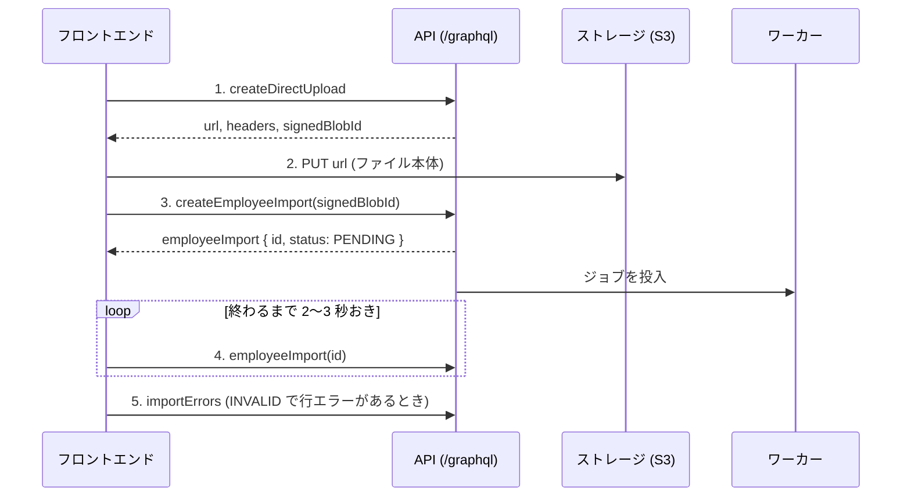

# 社員 CSV インポート API ガイド (フロントエンド向け)

画面から CSV をアップロードし、取り込み結果を表示するまでの API の使い方。
型と項目の意味は [schema.graphql](../schema.graphql) にある (各項目の説明はスキーマに書いている)。
このガイドでは、スキーマだけでは分からない **呼ぶ順番** と **結果の扱い方** を書く。

## 前提

- エンドポイントは `POST /graphql` の 1 つ (GraphQL)。CSV のファイル本体だけは、GraphQL ではなくストレージ (本番は S3) へ直接 `PUT` する
- 認証は既存の仕組みを使う。このサンプル実装では `X-User-Id` ヘッダーでユーザーを指定する
- 対象はログインユーザーのテナントのデータだけ。他テナントのインポートは `null` になる
- TypeScript の型は、`schema.graphql` から [GraphQL Code Generator](https://the-guild.dev/graphql/codegen) などで生成できる

## 流れ



### 1. アップロード先を発行する

ファイルサイズ (上限 10MB) と MD5 (Base64) をブラウザで計算して渡す。MD5 は spark-md5 などのライブラリで計算できる。

```graphql
mutation CreateDirectUpload($input: CreateDirectUploadInput!) {
  createDirectUpload(input: $input) {
    url
    headers
    signedBlobId
    errors { message }
  }
}
```

```json
{ "input": { "filename": "employees.csv", "byteSize": 2370000, "checksum": "(ファイルの MD5 を Base64 にした値)", "contentType": "text/csv" } }
```

`errors` が空でなければ、`message` をそのまま表示する (例: ファイルサイズの上限超え)。

### 2. ファイル本体をアップロードする

返ってきた `url` に、`headers` をそのまま付けて `PUT` する。URL の有効期限は 5 分 (Active Storage の既定) なので、発行したらすぐに送る。

```js
await fetch(url, { method: "PUT", headers, body: file })
```

### 3. 取り込みを受け付ける

```graphql
mutation CreateEmployeeImport($signedBlobId: String!) {
  createEmployeeImport(input: { signedBlobId: $signedBlobId }) {
    employeeImport { id status }
    errors { message }
  }
}
```

API は受け付けるだけで、すぐ返る (`status` は `PENDING`)。取り込みはワーカーが非同期で行う。
`errors` が空でなければ受け付けていない。同じテナントで終わっていないインポートがある場合もここで断られる。

### 4. 終わるまで状態を取得する

```graphql
query EmployeeImport($id: ID!) {
  employeeImport(id: $id) {
    status
    totalRows
    importedCount
    errorCount
    failureReason
  }
}
```

`status` が `PENDING` / `PROCESSING` のあいだは 2〜3 秒おきに取得する。5 万行でも処理は数秒で終わる。
終了後の表示は次のとおり。終了した状態はそれ以降変わらない。

| status | 意味 | 画面に出すもの |
|---|---|---|
| `COMPLETED` | 全件登録した | `importedCount` 件を登録したこと |
| `INVALID` | 入力エラーがあり、1 件も登録していない | `failureReason` があればそれ (ファイル自体の問題)。なければ 5. の行エラーの一覧 |
| `FAILED` | システムエラーで、1 件も登録していない | `failureReason`。同じファイルでもう一度アップロードしてもらう |

どの失敗でも、一部だけ登録された状態にはならない。直したファイルを、1. からやり直してアップロードすればよい。

### 5. 行エラーを取得する

行エラーは行番号順で、1 ページ最大 1,000 件。`errorCount` は行ではなく「行 × 列」の件数なので、行数より多いことがある。

```graphql
query ImportErrors($id: ID!, $after: String) {
  employeeImport(id: $id) {
    errorCount
    importErrors(first: 100, after: $after) {
      nodes { rowNumber column message }
      pageInfo { hasNextPage endCursor }
    }
  }
}
```

`rowNumber` は CSV 上の行番号 (ヘッダーが 1 行目) なので、Excel で開いたときの行番号と一致する。

## エラーの返り方

| 種類 | 返り方 | 対応 |
|---|---|---|
| 利用者が直せるエラー (ファイルサイズ、実行中のインポートなど) | 各 mutation の `errors` (HTTP 200) | `message` をそのまま表示する |
| ファイルの中身のエラー | インポートの `status` が `INVALID` / `FAILED` (4. を参照) | 4. と 5. のとおり表示する |
| 認証されていない | HTTP 401 | ログイン画面へ戻す |
| クエリの誤り | GraphQL のトップレベルの `errors` (HTTP 200) | 開発時の不具合として扱う |
