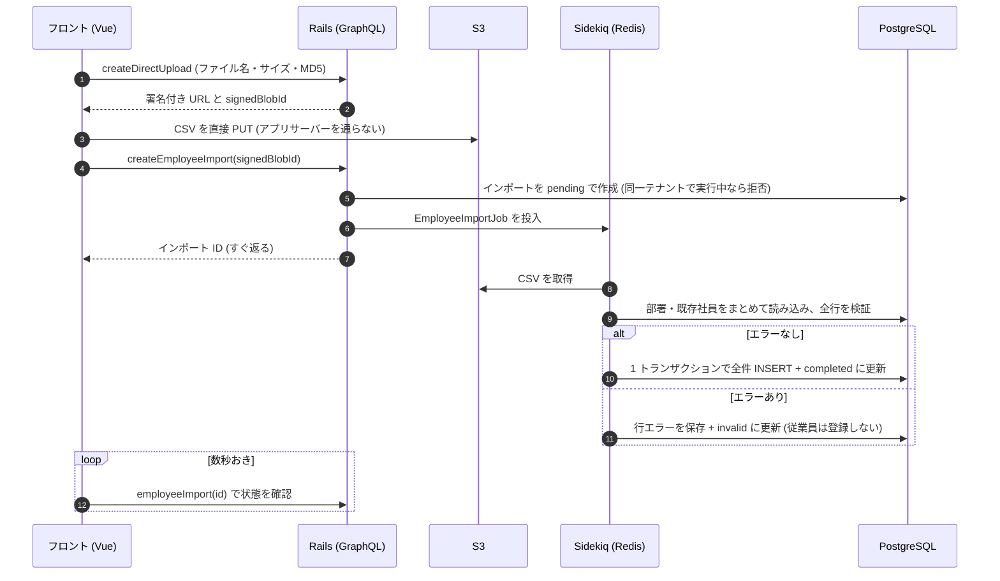
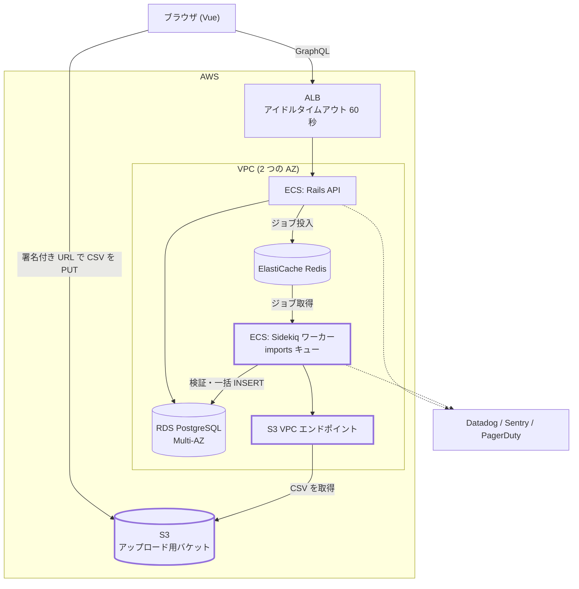
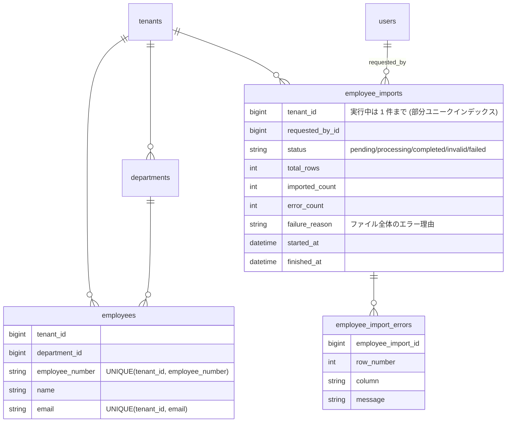
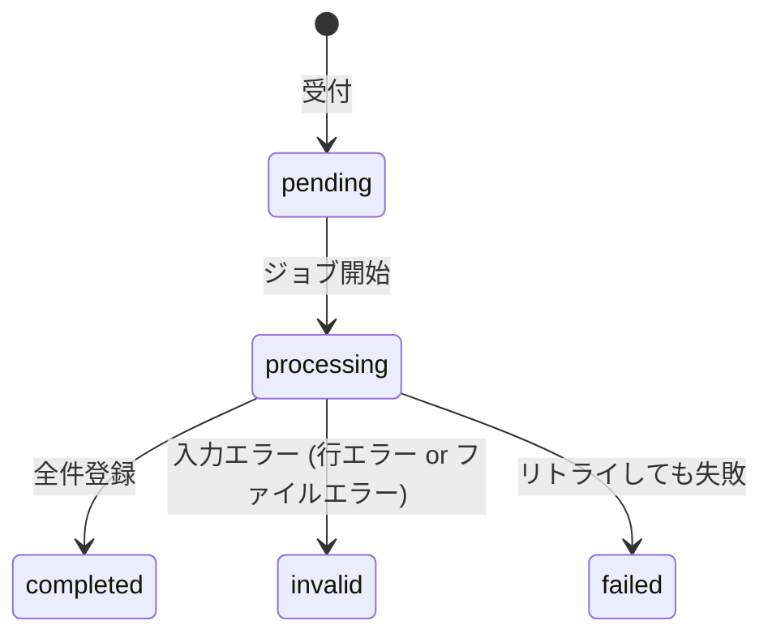

# 従業員 CSV 一括登録機能 設計書

人事担当者が従業員情報の CSV をアップロードし、従業員を一括で新規登録する機能の、仕様提案・設計・実装上の考慮点をまとめる。

ファイルのアップロードとインポートの受付を登録処理から切り離し、レスポンスは 1 分の制限に関係なくすぐ返す。登録はジョブで行い、入力エラーが 1 行でもあれば 1 件も登録せずに全件を差し戻す。ローカル環境の計測では、5 万行のファイル取得から登録完了まで 3.34〜3.54 秒だった (5 章)。
主要処理は Rails (API) で実装し、テストと計測まで行った。

- 実装: [`app/services/employee_imports/`](../app/services/employee_imports)、[`app/graphql/`](../app/graphql)、[`app/jobs/employee_import_job.rb`](../app/jobs/employee_import_job.rb)
- テスト: [`spec/`](../spec) (32 件)
- 計測: [`script/benchmark_import.rb`](../script/benchmark_import.rb)

## 1. 前提条件

| 条件 | 設計への影響 |
|---|---|
| CSV は最大 5 万行 | 1 行ずつ処理すると間に合わない。まとめて照合・登録する |
| リアルタイム性は不要だが、速いほど良い | 非同期処理にしてよい。そのうえで処理時間も短くする |
| レスポンスは 1 分でタイムアウトし、変更できない | **リクエストの中で登録処理をしない**。受付だけしてすぐ返す |
| 項目は「社員番号 (キー)・氏名・email・所属部署名」 | 社員番号で一意性を判定する。部署は名前から ID に変換する |
| 部署は別テーブルで管理 | 部署名の照合方法 (表記ゆれ・存在しない部署) を決める必要がある |
| 処理中に他者・他機能が従業員を参照・更新・削除しない | 既存社員の行ロックや楽観ロックは不要。ただし新規登録は除外されていないため、他の経路から同じ社員番号・email が登録されうる。最終的な一意性は DB の一意制約で保証する |
| 技術スタック: Rails / Vue.js / GraphQL / PostgreSQL / Redis / AWS | ジョブキューは Sidekiq (Redis)、ファイル置き場は S3 |

利用者は人事担当者で、CSV は Excel で作られることが多いと想定した。扱うのは個人情報なので、テナント (顧客企業) 間の分離と、誰がいつ登録したかの記録を重視する。

## 2. 仕様の提案

顧客と合意すべき論点について、推奨案と理由をまとめる。

| # | 論点 | 推奨案 | 理由・検討した代替案 |
|---|---|---|---|
| 1 | エラー行があったとき | **全件を検証し、1 件でもエラーがあれば 1 件も登録しない** (All-or-Nothing) | 正常な行だけ登録すると、修正して再アップロードしたときに登録済みの行が「重複」エラーになる。利用者が「どこまで入ったか」を追う必要もなくなる。代替案の部分登録は、件数が多くエラーが少数の運用で便利だが、まずは分かりやすさを優先した |
| 2 | 登録済みの社員番号 | エラーにする (更新しない) | 依頼は「新規登録」。更新 (upsert) は誤った CSV で既存データを上書きする危険があり、別機能として確認画面とセットで設計すべき |
| 3 | 存在しない部署名 | エラーにする (自動作成しない) | 自動作成すると「営業部」「営業部 」「営業１部」のような表記ゆれで部署が乱立する。部署マスタの整備は管理画面で行ってもらう |
| 4 | 表記ゆれ | 全角英数字→半角、前後の空白除去、email の小文字化を行ってから照合する | Excel で入力されたデータに多い揺れを、利用者の手間なく吸収する。部署名も同じ正規化をして照合する。正規化すると同じ名前になる部署がマスタに複数ある場合 (「営業１部」と「営業1部」) は、どちらか決められないのでエラーにする |
| 5 | CSV 内の重複 | 社員番号・email の重複は、後に出てきた行をエラーにし「n 行目と重複」と示す | どちらが正しいかはシステムで判断できないため、利用者に直してもらう |
| 6 | email の一意性 | テナント内で一意 | ログイン ID や通知先として使われる想定。他テナントとは重複してよい |
| 7 | 文字コード | UTF-8 (BOM の有無どちらも) と Shift_JIS (CP932) を自動判定 | Excel の「CSV」保存は Shift_JIS になる。利用者に文字コードを意識させない |
| 8 | 列 | ヘッダー行必須。列は**名前**で判定し、順番は問わない。必須列が無ければファイル全体をエラー | 列の入れ替えに強く、別のファイルを誤って上げた場合もすぐ分かる |
| 9 | 上限 | 5 万行・10MB を超えたら受け付けない | 5 万行の CSV は実測 2.5MB 程度。余裕を持たせつつ、巨大ファイルからシステムを守る |
| 10 | 同時実行 | 同じテナントで実行中のインポートがあれば、新しいインポートは受け付けない | 2 つのインポートに同じ社員番号が含まれると、どちらかが途中で失敗する。直列にすれば検証結果どおりに登録できる |
| 11 | 結果の返し方 | 行ごとのエラーを「行番号・列名・理由」で返す。行番号は Excel の行番号と一致させる (ヘッダーが 1 行目) | 利用者が Excel で該当行をすぐ開ける |
| 12 | 記録 | インポートごとに、実行者・日時・件数・結果を保存する | 個人情報を扱う操作の追跡性を確保する (監査ログ) |

**対象外とするもの**: 既存従業員の更新・削除、部署の自動作成、登録した従業員への招待メールの送信 (大量送信は別ジョブで扱うべき)。

## 3. アーキテクチャ

### 処理の流れ



- **ファイルは S3 に直接アップロード**する。アプリサーバーが大きなファイルを受け取らないので、アップロード時間がタイムアウトに影響しない。Rails 標準の Active Storage の直接アップロードを使う。
- **mutation は受付だけして返す**。登録処理は Sidekiq のジョブで行う。インポート用のキュー (`imports`) を分け、他の非同期処理を詰まらせないようにする。
- **状態の確認は polling** にした。処理は数秒で終わるため、GraphQL Subscription (WebSocket) の接続管理を増やすほどの利点がない。

### インフラ構成 (AWS)

本番で想定する構成。太枠がこの機能のために追加するリソースで、それ以外は既存の構成に乗る想定。



| リソース | この機能での役割・設定 |
|---|---|
| ALB | アイドルタイムアウト 60 秒が「レスポンスは 1 分でタイムアウト」の制約に当たる。API は受付だけして返すので、この制約に掛からない |
| S3 (追加) | CSV の置き場所。サーバー側暗号化 (SSE-KMS)、パブリックアクセスの全面ブロック、ブラウザからの PUT 用の CORS、30 日で削除するライフサイクルルール |
| ECS: Sidekiq ワーカー (追加) | API とは別のサービスにし、重い処理が API の応答に影響しないようにする。`imports` キューの滞留数に応じて台数を増減する |
| S3 VPC エンドポイント (追加) | ワーカーが CSV を取得する通信をインターネットに出さない |
| IAM ロール | API は署名付き URL の発行に必要な `s3:PutObject` と、SSE-KMS の鍵でデータキーを作る `kms:GenerateDataKey` だけを持つ。ワーカーは `s3:GetObject` と、復号に使う `kms:Decrypt` だけを持つ。S3 の権限はアップロード用のプレフィックスに、KMS の権限はこのバケット用の鍵に限定する |
| RDS / ElastiCache | 既存のものを使う。5 万行の一括 INSERT は 1 トランザクションで数秒のため、専用の DB は不要 |

これらのリソースは既存の IaC ツールに合わせてコードで管理し、変更は GitHub Actions で plan の結果をプルリクエストに表示して、レビューしてから apply する想定。

### 処理の構成

インポート処理は 3 つのクラスに分けた。それぞれ単体でテストできる。

| クラス | 役割 |
|---|---|
| [`CsvReader`](../app/services/employee_imports/csv_reader.rb) | バイト列を行データにする。文字コード判定、ヘッダー確認、行数上限。ファイル全体を受け付けられない場合は `FileError` |
| [`RowValidator`](../app/services/employee_imports/row_validator.rb) | 行の正規化と検証。部署と既存社員をまとめて読み込み、Hash / Set で照合する。DB への書き込みはしない |
| [`Processor`](../app/services/employee_imports/processor.rb) | 上の 2 つを呼び、結果に応じて全件登録するか、エラーを保存する。ステータス遷移を管理する |

### データモデル



インポートのステータスは次のとおり遷移する。結果は「全件登録 (completed)」か「1 件も登録していない (invalid / failed)」のどちらかで、途中の状態は残らない。



### GraphQL API

```graphql
type Mutation {
  createDirectUpload(input: CreateDirectUploadInput!): CreateDirectUploadPayload  # 署名付き URL を発行
  createEmployeeImport(input: CreateEmployeeImportInput!): CreateEmployeeImportPayload  # インポートを受付
}

type Query {
  employeeImport(id: ID!): EmployeeImport  # 進捗と結果 (polling 用)
}

type EmployeeImport {
  id: ID!
  status: EmployeeImportStatus!  # PENDING / PROCESSING / COMPLETED / INVALID / FAILED
  totalRows: Int
  importedCount: Int!
  errorCount: Int!
  failureReason: String          # ファイル全体のエラー (文字コード・ヘッダーなど)
  importErrors(first: Int, after: String): EmployeeImportErrorConnection!  # 行エラー (ページング)
}
```

利用者が直せるエラー (ファイルサイズ超過、実行中のインポートがある等) は、GraphQL の `errors` ではなく payload の `errors` フィールドで返す。フロントはこれをそのまま画面に表示できる。行エラーは 5 万行で数万〜十数万件になりうるので、connection でページングして返す。

## 4. 考慮点と対策

### 4.1 タイムアウト (1 分)

| 考慮点 | 対策 |
|---|---|
| 5 万行の登録をリクエスト内で行うと 1 分を超えうる | 登録はジョブで非同期に行い、mutation は受付だけしてすぐ返す |
| ファイルのアップロード自体に時間がかかる | S3 への直接アップロードにして、アプリサーバーを経由させない |
| ジョブ側にもタイムアウトや強制終了がある (デプロイ時の再起動など) | 処理を冪等にして、途中で止まっても再実行で正しく終わるようにする (4.4) |

### 4.2 性能

1 行ずつ処理すると、部署の検索・重複チェック・INSERT がそれぞれ 5 万回発生する。実測で約 80 秒かかり、これは同期処理なら 1 分のタイムアウトを超える (5 章)。

| 考慮点 | 対策 |
|---|---|
| 部署の検索が N+1 になる | テナントの部署を最初に 1 回で読み込み、正規化した名前 → ID の Hash で引く |
| 既存社員との重複チェックが N+1 になる | CSV に出てくる社員番号・email だけを、5,000 件ずつの IN 句でまとめて問い合わせ、Set で照合する。テナントの社員数に比例しない |
| 1 行ずつの INSERT と ActiveRecord のバリデーション・コールバックが遅い | 検証は素の Ruby で済ませ、登録は `insert_all!` で 5,000 行ずつまとめて行う |
| メモリ使用量 | ファイル全体を一度に読み、パース結果・正規化した行・登録用データやエラーもメモリに持つ。5 万行 (2.3MB) では、処理中のメモリ増加は正常系で 62〜78MB、全行エラーで 30〜61MB だった (実測、5 章)。1 行が長くファイルが 10MB 上限に近い場合はこれより増える (推測)。本番のワーカー並列数は、本番相当の環境で正常系と大量エラー系のピークメモリを測って決める。上限を大きく上げる場合は、行を流しながら処理する方式に変える |

さらに速くする余地として PostgreSQL の `COPY` があるが、今回の規模では `insert_all` で数秒に収まり、`COPY` は一時テーブルなどの仕組みが増えるため採用しなかった。

### 4.3 データの整合性 (All-or-Nothing)

| 考慮点 | 対策 |
|---|---|
| 登録の途中で失敗すると、一部だけ登録された状態になる | 全件の INSERT と `completed` への更新を **1 つのトランザクション** で行う。失敗すればすべてロールバックされる |
| 検証後に他の経路から同じ社員番号・email が登録される | 前提で除外されているのは参照・更新・削除で、新規登録は起こりうる。`(tenant_id, employee_number)` と `(tenant_id, email)` に DB の一意制約を張り、最終的な一意性は DB で保証する。違反したら全件ロールバックし `failed` にして、再アップロードを促す |
| 5 万行を 1 トランザクションで入れるとロックが長くなる | 新規行の INSERT だけで既存行は更新しないため、既存社員の参照や更新は待たせない。ただし他の経路から同じ社員番号・email を新規登録すると、一意制約の確認のためその INSERT はこのトランザクションの終了まで待つ。実測で登録は 2〜3 秒なので、待ちもその範囲に収まる |

### 4.4 リトライと冪等性

| 考慮点 | 対策 |
|---|---|
| DB の一時的な障害などでジョブが失敗する | ActiveJob の `retry_on` で 3 回まで間隔を空けて再実行する。すべて失敗したら `failed` にして、`Rails.error.report` でエラーを報告する (本番は Sentry に届く) |
| 同じジョブが二重に実行される (Sidekiq は「最低 1 回」実行の保証) | 終了済み (`completed` / `invalid` / `failed`) のインポートは何もせず返す。登録とステータス更新が同じトランザクションなので、「登録済みなのに未完了」の状態は存在しない |
| 同じインポートを 2 つのワーカーが同時に処理する | 両方が終了判定と検証を通ると、後のワーカーは先に登録された行を「重複」と判定し、`completed` を `invalid` や `failed` で上書きしうる。処理の開始時と結果の書き込み時に **インポートの行をロック** して最新の状態を読み、別のワーカーが先に終えていれば何もしない。リトライが尽きたときの `failed` への更新も同じ。時間のかかる読み込みと検証の間はロックを持たないため、2 つのワーカーがどちらも検証まで進むことはある。直列にするのは結果の確定だけで、社員・行エラーの保存とステータスの確定は一度しか起きない。片方が検証を終えた直後にもう片方が完了する順序をテストで再現し、先に確定した `completed` が保たれることを確認した。なお 4.5 の部分ユニークインデックスが防ぐのは「同じテナントにインポートを 2 件作ること」で、同じインポートの結果の二重書き込みはこのロックで防ぐ |
| ワーカーが処理中に止まる (デプロイ・障害) | トランザクションがロールバックされ、ステータスは `processing` のまま残る。Sidekiq は正常な停止なら未完了のジョブをキューに戻すので、再実行で最初からやり直せる。強制終了ではジョブが失われることがある (無償版の Sidekiq) ため、一定時間 `processing` のままのインポートを検知する仕組みを本番では入れる (7 章) |
| 受付後、ジョブがキューに入らない | インポートの作成 (`pending`) とジョブの投入は別の操作のため、間で API が落ちたり Redis に繋がらなかったりすると、`pending` のまま残る。そのテナントは次のインポートも受け付けられなくなる。`processing` と同じく、通常のキュー待ちより十分長い時間 `pending` のままのものを定期ジョブで検知して再投入する。上のロックがあるので、元のジョブが遅れて動いても結果は二重に書き込まれない (7 章) |

### 4.5 同時実行

| 考慮点 | 対策 |
|---|---|
| 同じテナントで 2 つのインポートが同時に走ると、検証時は通った社員番号が競合する | 「同一テナントで `pending` / `processing` のインポートは 1 件まで」を **部分ユニークインデックス** で DB に保証させる。アプリでの事前チェックと違い、同時に 2 リクエストが来ても確実に 1 つだけ通る |
| 画面の二度押し | 上と同じ仕組みで 2 回目は「実行中のインポートがあります」と返る |

### 4.6 入力データの品質

| 考慮点 | 対策 |
|---|---|
| Excel 由来の Shift_JIS、BOM 付き UTF-8 | まず UTF-8 として読み、不正なら CP932 として変換する。どちらでもなければファイルエラー |
| 全角英数字、前後の空白、大文字の email | Unicode 正規化 (NFKC) と空白除去、email の小文字化をしてから検証・登録する |
| Excel が出力する末尾の空行 | すべての列が空の行は読み飛ばす |
| 列の並び替え、余分な列 | 列名で判定するので並びは問わない。余分な列は無視する |
| 1 つの行に複数のエラー | 行ごとに全項目を検証し、まとめて返す。利用者が 1 回の修正で直せる |

### 4.7 エラーの返し方

- **ファイル全体のエラー** (文字コード・ヘッダー・行数): `failureReason` に 1 つの理由を返す。
- **行ごとのエラー**: `importErrors` に「行番号・列名・理由」で返す。行番号は Excel の行番号と同じ。
- **すぐ分かるエラー** (サイズ超過・実行中のインポートあり): mutation の `errors` で即座に返し、ジョブを投入しない。

エラー件数が多い場合に備え、本番ではエラー一覧の CSV ダウンロードも用意したい (7 章)。その際は、セルの先頭が `=` `+` `-` `@` の値を無害化して、Excel で開いたときに式として実行される「CSV インジェクション」を防ぐ。

### 4.8 セキュリティと個人情報

| 考慮点 | 対策 |
|---|---|
| 他テナントのデータの参照・混入 | クエリは必ずログインユーザーのテナントで絞る (`current_user.tenant.employee_imports`)。部署・既存社員の照合もテナント内に限定する。GraphQL の汎用 `node(id:)` は他テナントのオブジェクトを取れてしまうため置いていない |
| 他テナントがアップロードしたファイルの取り込み | `signedBlobId` の署名が正しくても、それだけでは誰のファイルか分からない。署名付き URL を発行するときにテナント ID をファイルの情報に記録し、インポート受付時にログインユーザーのテナントと一致しなければ拒否する |
| 巨大なファイルによる負荷 | 署名付き URL の発行前と、インポート受付時の 2 か所でサイズを確認する。行数はパース時に確認する |
| アップロードされた CSV (個人情報) の保管 | S3 はサーバー側暗号化を有効にし、パブリックアクセスを禁止する。処理後のファイルは保持期間 (例: 30 日) を決めてライフサイクルルールで削除する |
| ログへの個人情報の出力 | 行の内容 (氏名・email) はログや Sentry に出さず、インポート ID と行番号だけを出す |
| 誰が登録したか | `employee_imports` に実行者・日時・件数・結果を保存する |

### 4.9 運用・監視

| 考慮点 | 対策 |
|---|---|
| ジョブの失敗に気づけない | リトライが尽きたらエラーを Sentry に送る。`failed` の件数を Datadog で監視し、閾値を超えたら PagerDuty で呼び出す |
| 処理時間の悪化に気づけない | ジョブの処理時間と行数を Datadog のメトリクスに送り、行数あたりの時間を見る |
| キューの詰まり | `imports` キューの滞留数と待ち時間を監視する |

### 4.10 テスト

RSpec で 32 件のテストを書いた。DB を使い、実際の振る舞いを確認している。

| 対象 | 確認している内容 |
|---|---|
| `CsvReader` | 行番号、列の並び替え、BOM 付き UTF-8、Shift_JIS、空行、必須列の欠落、行数上限、文字コード不明 |
| `RowValidator` | 正規化、必須・形式・存在しない部署、正規化すると同じ名前になる部署、CSV 内の重複、登録済みとの重複、他テナントとは重複しないこと |
| `Processor` | 全件登録、エラー時に 1 件も登録しないこと、ファイルエラー、再実行で二重登録しないこと、**2 つのワーカーが競合する順序で同じインポートを処理しても、先に確定した結果が保たれること**、**登録の途中で DB エラーが起きたら全件ロールバックし、再実行で完了できること** |
| GraphQL API | 直接アップロード→受付→ジョブ→結果確認の一連の流れ、行エラーの返し方、同時実行の拒否、サイズ上限、他テナントがアップロードしたファイルを取り込めないこと、他テナントから見えないこと、未認証の拒否 |

## 5. 計測結果

`bin/rails runner script/benchmark_import.rb 50000 --naive` で、5 万行 (Shift_JIS 2.3MB、部署 50 件) を計測した。環境は Apple M1 Max、Ruby 3.4、ローカルの PostgreSQL 16 で、複数回実行した最小〜最大を示す。

| 計測内容 | 時間 |
|---|---|
| 読み込み (文字コード変換 + CSV パース) | 0.18〜0.22 秒 |
| 検証 (部署・重複チェック) | 0.81〜0.88 秒 |
| **Processor 全体 (ファイル取得〜全件登録)** | **3.34〜3.54 秒** |
| 既存社員 5 万人がいる状態で全行が重複エラー (エラー 10 万件を保存) | 3.88〜4.02 秒 |
| 比較: 1 行ずつ部署を検索して `create!` する素朴な実装 | **80.2 秒** |

メモリは `--memory` を付けて別に実行して計った (メモリの読み取りが処理時間に影響するため)。Processor 実行中の RSS の最大増加を 3 回計った結果は次のとおり。Rails プロセス自体は約 90MB。

| 計測内容 | メモリ (RSS) の最大増加 |
|---|---|
| 正常系 (5 万件登録) | 62〜78MB |
| 全行が重複エラー (エラー 10 万件) | 30〜61MB |

全行エラーは正常系に続けて同じプロセスで計るため、既に確保したメモリが再利用され、増加量は小さめに出ている可能性がある。

まとめて照合・登録することで、素朴な実装の **約 20 倍** 速くなった。素朴な実装は、同期処理であれば 1 分のタイムアウトを超える。本番は DB がネットワーク越しになるため、1 往復ごとの遅延が積み上がる素朴な実装との差はさらに広がると見込む (推測)。

## 6. 設計判断のまとめ

| 判断 | 採用 | 採用しなかった案と理由 |
|---|---|---|
| 処理方式 | 非同期ジョブ (Sidekiq) | 同期処理: 実測 3〜4 秒で収まるが、データ量や DB 負荷の変動でタイムアウトに近づく。タイムアウトは変更できないため、余裕を持てない設計は避けた |
| 進捗の通知 | polling | GraphQL Subscription: 処理が数秒で終わるため、WebSocket の接続管理を増やす利点が小さい |
| 失敗時の扱い | All-or-Nothing | 部分登録: 再アップロード時の重複エラーと、「どこまで入ったか」の管理が利用者の負担になる |
| 一括登録 | `insert_all!` | `COPY`: 速いが仕組みが増える。activerecord-import gem: Rails 標準の `insert_all` で足りる |
| 同時実行の制御 | 部分ユニークインデックス | アプリでの事前チェック: 同時リクエストですり抜ける。Redis のロック: 期限切れやロック解放漏れを考える必要がある |

## 7. 本番に向けて残っていること・今後の拡張

サンプル実装では次を省略している。

- **認証**: サンプルは `X-User-Id` ヘッダーでユーザーを指定する簡易実装。既存の認証の仕組みに置き換える。権限 (人事担当者だけが実行できる) の確認も加える。
- **止まったインポートの検知**: 一定時間 `pending` / `processing` のままのインポートを定期ジョブで見つけ、再投入するか `failed` にする。閾値は通常のキュー待ちと処理時間より十分長くする。
- **エラー一覧の CSV ダウンロード**: エラーが多い場合、画面で見るより Excel で直す方が早い。元の CSV にエラー列を足して返す形が使いやすい。
- **完了通知**: 処理が長くなる場合に備え、画面を閉じても結果が分かるよう、アプリ内通知やメールで知らせる。
- **アップロードファイルの削除**: 保持期間を過ぎた CSV を削除する。
- **更新 (upsert) 対応**: 「既存の社員は更新する」モードの要望が出た場合は、差分の確認画面 (追加 n 件・更新 n 件) を挟んでから実行する設計にする。
- **さらなる大規模化**: 行数上限を大きく上げる場合は、全行をメモリに載せず流しながら処理し、検証用の一時テーブルを使う方式に切り替える。
